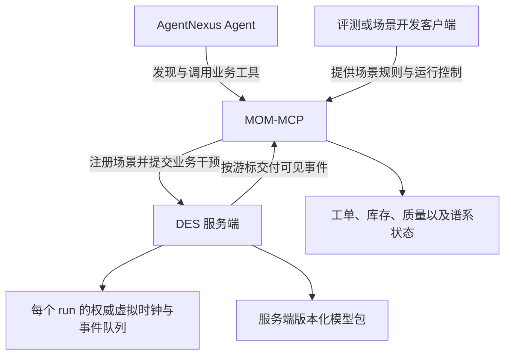

# MOM-MCP 架构设计

## 目标与边界

AgentNexus 的 Agent 可以在多个虚拟工厂中查找工具、理解工况、执行有限的制造动作并检查结果。ISA-95 Level 3 的生产、库存、质量和维护用于校准场景范围。ERP 和设备侧通过 mock 业务事件表达。认证、财务、设备协议、APS 求解及人类操作工作台超出本项目的交付范围。项目介绍页描述能力、场景及调用示例。独立的浏览器验收台用于开发、演示和用户测试，通过与 Agent 共用的 MCP 契约操作隔离的模拟实例。

设计来源包括 Carbon 的搜索与业务命令、qcadoo 的显式状态及记录纠正、OpenMES 的工单快照、WebErpMesv2 的序列号追溯。AgentNexus 的 `an-des` 已有标签随机流、CNC 推演和重放，`an-des-mcp` 已有 stdio 入口。当前 `Pattern::Script` 固定报警时刻，适合旧场景回归。新场景的时间通过规则和随机流生成。现有 DES 基线为 `Grant-Huang/multi-agent-conv-mvp@e0a21d3`。

- [Carbon MCP](https://github.com/crbnos/carbon/tree/2f5b652498539be79372635666f1ccc45f5cb601/packages/ee/src/mcp)
- [qcadoo MES](https://github.com/qcadoo/mes/tree/625afad7a8adaaa65b5b8b7bd7867af21aafc960/mes-plugins)
- [OpenMES 工单快照](https://github.com/Mes-Open/OpenMes/blob/faccc52a543382922aa8b7d9d79b89e6a30b28d3/backend/app/Services/WorkOrder/WorkOrderSnapshotService.php)
- [WebErpMesv2 追溯](https://github.com/SMEWebify/WebErpMesv2/blob/8fa6c05452ce5a5e3d0bf68ef1592446c1858a54/app/Http/Controllers/ProductionTraceController.php)
- [现有 DES 接口](https://github.com/Grant-Huang/multi-agent-conv-mvp/blob/e0a21d3/crates/des/src/lib.rs)

## 技术栈

MOM-MCP 运行端采用全 Rust。使用 Cargo workspace、固定工具链和 `Cargo.lock`，按需拆分 MCP 服务、制造业务与持久化、DES 内核和模型包。MCP 使用 Rust SDK `rmcp`，共享数据契约使用 Serde，业务数据持久化使用 SQLite。验收环境使用 Axum 提供静态页面与测试专用 HTTP 桥，浏览器通过该桥调用 Rust MCP。静态页面使用 HTML、CSS 和必要的浏览器脚本，Playwright 使用 Node.js 测试工具链，二者均不参与生产后端运行。

P0 的维护入口为 Rust 接入探针。迁移以既有 Python 探针的发现、结构化回包和写入行为为对照，并单独验证了重连恢复。DES 在同一 Rust 依赖图内复用，通过清晰的服务接口隔离内核和模型，保持将来独立发布的能力。共享时钟由 Rust DES 服务端持有，每个 run 保持单一权威时钟。P0 以 stdio 验证 AgentNexus 接入，跨独立宿主的共享部署待有具体需求时设计。

## 调用关系

MOM-MCP 是 DES 的客户端，随项目交付的行业示例也用与外部客户端一致的场景 schema。DES 服务持有每个 run 的权威时钟。MOM-MCP 投影只保留 DES 确认的时间和游标用于一致性查询。一个 run 内所有 Agent、设备、工序和模型共享此时钟。不同 run 独立推进。控制调用可以等待下一事件，或声明最多处理多少事件、最多运行多长的虚拟时长。读取时钟、读取业务数据以及真实时间流逝均不推进仿真。

## MCP 与运行实例

| 工具 | 契约 |
|---|---|
| `list_scenarios` | 返回场景版本、简介、可用能力和参数 schema，省略评测标准答案和未来观测 |
| `open_scenario` | Agent 选择已发布场景版本及允许的运行参数，如种子和模拟时长，获得 `run_id`、版本和已提交游标 |
| `get_run` / `close_run` | 查询运行状态并结束自己的实例。多个 Agent 可由宿主显式共享同一实例 |
| `search_tools` | 按 `run_id`、查询词、业务域及读写属性检索。使用同义词、对象字段和稳定的排序，返回工具名和摘要 |
| `describe_tool` | 返回输入输出 schema、前置条件、副作用、错误码和可见性 |
| `call_tool` | 传入 `run_id`、工具名和参数。写工具传幂等键，受并发影响的业务对象使用预期版本 |

跨工具切换通过传入目标 `run_id` 完成。工具列表、描述和调用共用注册表，执行时再次验证场景能力与调用权限。AgentNexus 目前对 MCP 顶层工具配置静态权限。可代理写动作的 `call_tool` 需要配置为 `workspace_write`，服务端按实际工具和运行实例执行更细的校验。MCP 初期验证 stdio 链路。场景注册、时间推进、评测取证使用独立于 Agent 工具面的控制入口。测试进程从隔离的控制接口读取答案和未来轨迹。可预期的业务拒绝使用结构化结果，包含稳定错误码、相关对象、是否可重试及可公开的阻塞原因。MCP 协议工具错误由 AgentNexus 统一映射为宿主错误。

## 场景输入、模型与随机时间

- **场景定义**由客户端提交。包含 schema 版本、场景 ID 与版本、初始工厂数据、模型包及其参数、外生事件规则和场景能力。工艺时长、故障率、到达率和响应延迟以规则或分布参数描述。拒绝外部事件的绝对发生时刻、预排事件表和可执行代码。
- **运行配置**包含种子、相对运行时长、事件预算等允许的覆盖项。DES 确定本次运行的时间原点和所用参数，并记录规范化输入的摘要。业务日历或班次是规则的一部分。
- **DES 内核**拥有事件队列、虚拟时钟、标签随机流、稳定排序、取消重排和日志重放。模型提出候选事件及其延迟、风险或触发条件，由内核抽样并安排。使用整数虚拟时间，明确量化舍入及同刻顺序，以稳定序号消除歧义。拒绝过去事件，限制同刻循环和总步数。
- **服务端模型包**提供版本、参数 schema、初始化、事件处理、干预及可公开观测映射。第一版可用编译期链接、服务端启动时注册，运行时按 ID 和版本实例化。CNC 磨损、刀具、振动、尺寸及阈值均归 CNC 模型包。该包可以申请定期采样事件。跨行业模型通过同一接口加载。
- **干预与重放**在服务端当前时间接受动作，完成时间按条件重新安排。例如维修完成后磨损下降，原故障候选取消。事件日志记录场景、模型和引擎版本、种子、有效参数、控制命令、业务干预及其接收顺序。游标已覆盖的历史固定，同刻的新事件取得更大的序号。对照运行使用独立标签随机流，避免改变一种扰动就打乱所有随机源。

## 数据与一致性

主数据用小型、可读的行业夹具，包含物料版本、BOM、路线、设备、库存批次及检验规格。场景打开时校验引用、单位、数量、序列号和资源约束。工单下达后固化实际使用的工艺版本。初始数据与已处理事件共同决定查询结果。DES 生成订单到达、停机、质检读数和召回等事实，MES 动作形成新的业务事件。谱系记录投入批次、产出批次或序列号及工序执行之间的关系，时间线从同源事件投影。

工单、工序和质量冻结分别管理状态。示例工序流为待派工 → 就绪 → 执行 → 完工。前序未完工、设备不可用、物料隔离或数量不足时返回可解释的拒绝。报工事务写入实绩、消耗、产出、谱系和审计事件，失败时整体回滚。纠正通过关联原记录的冲销或补正完成。每个 run 的命令串行受理，幂等键按运行与调用范围存储。

首版建议用 SQLite 带事务地写业务状态、输入游标、幂等结果和待传的模型干预。跨进程时使用稳定事件 ID、连续游标与幂等干预 ID 重试。若业务动作需 DES 受理才生效，先返回待处理状态，收到确认后更新为已生效。读取投影返回已应用的游标。推进或成功动作须等到所承诺的状态可见，或明确返回待追平状态。服务崩溃后的恢复以已提交的运行记录和版本化重放为依据，重复事件不能再次扣料或创建工单。

## 扩展与发布

Rust 内核、服务与行业模型包使用独立依赖边界。保留 AgentNexus 旧 CNC 调用的兼容入口，以同一基线做轨迹对比。至少在 CNC 与 SMT 同用新接口、且模型注册无需更新内核后，评估拆仓或发布独立版本。拆仓时固定模型与运行协议的版本矩阵，并为既有记录保留重放途径。验收与实施依赖见 [实施计划](IMPLEMENTATION_PLAN.md)。

### P2 运行边界

MOM-MCP 在 SQLite 事务内保存每个 run 的 DES 队列、当前时钟、可见事件及控制命令。跨 stdio 进程访问同一数据库和 run ID 时，共用这份状态。控制入口使用显式启动开关，普通客户端只能读取已交付事件。公开事件游标 `event_cursor` 与 P1 工具的业务游标独立。

Cargo workspace 包含通用 `mom-des`、`mom-model-cnc` 和 `mom-model-fixture`。CNC 模型提供模拟磨损和观测值，模型注册表按 ID 与版本加载。旧 DES 入口及既有完整固定剧本继续在 AgentNexus 上独立运行，由同一验收门槛复跑。
